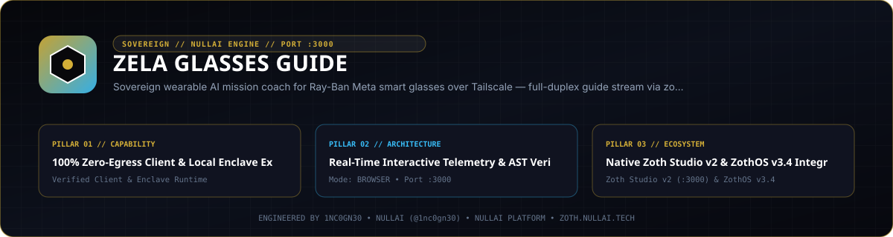

<div align="center">
  
</div>

<br />

<div align="center">
  <a href="https://zoth.nullai.tech/tools/zela-glasses-guide"></a>
  <a href="http://127.0.0.1:8144"></a>
  <a href="https://buy.stripe.com/3cIfZg27PdKo2D64Ocfw40X"></a>
  <a href="LICENSE"></a>
</div>

# Zela Glasses Guide

Wearable AI mission coach workstation and configuration deck (`127.0.0.1:8144`) for Ray-Ban Meta Smart Glasses paired over Tailscale WireGuard to `zoth-relay-mobile` (`:8766`). Combines local `moondream` edge vision captioning via Ollama (`127.0.0.1:11434`), persistent `stream-json` coaching sessions with pre-warmed 14-turn rolling spares, and 24 kHz Kokoro v1.0 ONNX voice synthesis (`af_heart`) with barge-in cancellation.

## Overview

| Property | Specification |
| :--- | :--- |
| **Tool ID** | `zela-glasses-guide` |
| **Category** | `Swarm & Core` |
| **Loopback Workstation** | `http://127.0.0.1:8144` (`python3 server.py --host 127.0.0.1 --port 8144`) |
| **Mobile Relay Endpoint** | `ws://127.0.0.1:8766/v1/guide/stream` or `ws://<tailscale-ip>:8766/v1/guide/stream` |
| **Zoth Studio v2 Dossier** | [`https://zoth.nullai.tech/tools/zela-glasses-guide`](https://zoth.nullai.tech/tools/zela-glasses-guide) (`http://127.0.0.1:3000/tools/zela-glasses-guide`) |
| **ZothOS v3.4.0 CLI** | `zela-glasses-guide` (`bin/zela-glasses-guide`) and `zela-glasses-guide-tui` |
| **License** | MIT — 100% Free & Open-Source |

## Architecture

1. **Interactive HUD Simulator & Config Deck (`public/index.html`, `public/possibilities.html`, `server.py`)**
   - Serves an interactive smart-glasses optical HUD simulator covering 6 domain mission presets (`Repair`, `Hardware`, `Daily`, `Security`, `DevOps`, `Mobility`), WebSocket relay tester, and exportable `zoth-relay-mobile` YAML configuration bundle.
2. **Full-Duplex Relay Pipeline (`zoth-relay-mobile` `:8766`)**
   - **Vision Stage**: Scene-changed smart-glasses frames arrive over encrypted Tailscale WireGuard (`<tailscale-ip>:8766/v1/guide/stream`) and are captioned locally in RAM via Ollama `moondream` (`keep_alive: 10m`, thermal ceiling `hot_c: 88`).
   - **Coaching Stage**: Persistent `agy` `stream-json` loop (`roll_turns: 14`, `roll_chars: 6000`) swaps seamlessly to a pre-warmed spare session to avoid context latency spikes.
   - **Voice Stage**: Streaming speech markers feed local Kokoro v1.0 ONNX (`kokoro-v1.0.onnx`, `af_heart`, 24 kHz PCM16LE, `chunk_ms: 200`) with immediate barge-in cancellation.

## Quickstart

```bash
git clone https://github.com/1nc0gn30/zela-glasses-guide.git
cd zela-glasses-guide

# Launch the loopback workstation on 127.0.0.1:8144
python3 server.py --host 127.0.0.1 --port 8144 --tailscale-ip <tailscale-ip>
```

### Environment Variables

| Variable | Default | Purpose |
| :--- | :--- | :--- |
| `ZELA_HOST` | `127.0.0.1` | Default bind host for `server.py` |
| `ZELA_TAILSCALE_IP` | `<tailscale-ip>` | Tailscale mesh IP populated into `/api/status` and `/api/config` YAML |

## CLI & MCP Usage

### ZothOS v3.4.0 CLI (`bin/zela-glasses-guide`)

```bash
./bin/zela-glasses-guide --help
./bin/zela-glasses-guide --status
./bin/zela-glasses-guide --json
./bin/zela-glasses-guide --presets --json
./bin/zela-glasses-guide --config --tailscale-ip <tailscale-ip>
./bin/zela-glasses-guide --ui
./bin/zela-glasses-guide --serve 8144 --tailscale-ip <tailscale-ip>
```

### REST API Endpoints (`127.0.0.1:8144`)

- `GET /health`, `GET /api/health` — Daemon health, engine label, version, port, and open-access status.
- `GET /api/status` — Relay port (`8766`), configured `tailscale_ip`, vision/TTS engine specs, and preset count.
- `GET /api/presets` — 6 wearable mission presets (`s1`–`s6`) with category and local vision model metadata.
- `GET /api/config` — Sample `~/.config/zoth-relay/mobile/config.yaml` payload.

## Testing & Verification

```bash
# Run HTTP endpoint and relay YAML invariant tests
python3 -m pytest -q

# Verify CLI flags and deterministic JSON output
./bin/zela-glasses-guide --help
./bin/zela-glasses-guide --json
```

## Support

Zela Glasses Guide is 100% free and open-source with zero paywalls. Optional support: [Buy Us a Coffee via Stripe](https://buy.stripe.com/3cIfZg27PdKo2D64Ocfw40X).

## License

Released under the [MIT License](LICENSE). Engineered by [1nc0gn30](https://1nc0gn30.si) (`@1nc0gn30`) and [NullAI](https://nullai.tech).
